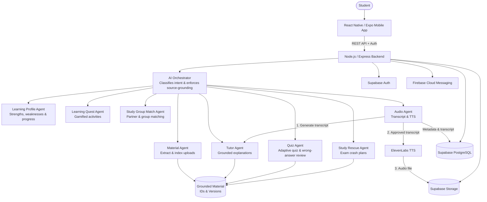
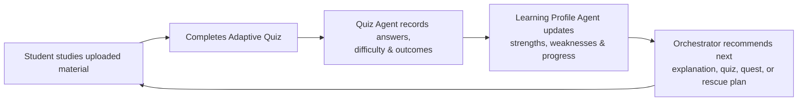
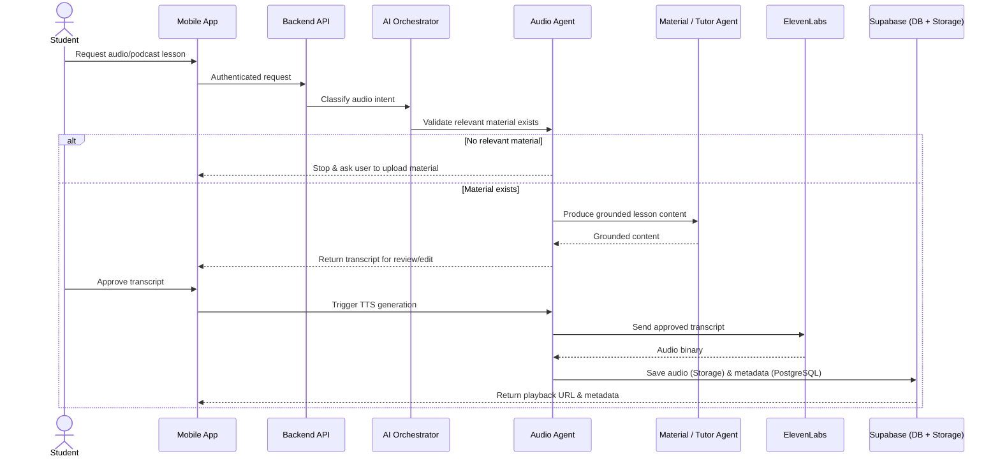
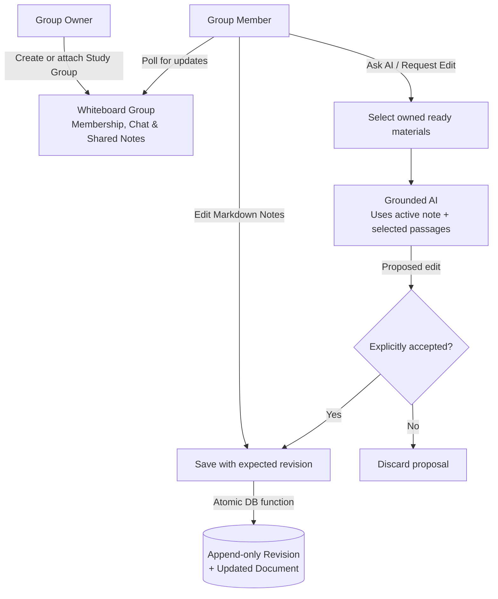

# AI Study4All — System & User Workflows

This document visualizes the end-to-end workflows of **AI Study4All** based on [System Architecture](ARCHITECTURE.md).

---

## 1. End-to-End System & Agent Workflow

---

## 2. Adaptive Learning Loop

---

## 3. Audio Learning Request Flow

---

## 4. Collaborative Whiteboard & Grounded AI Flow

